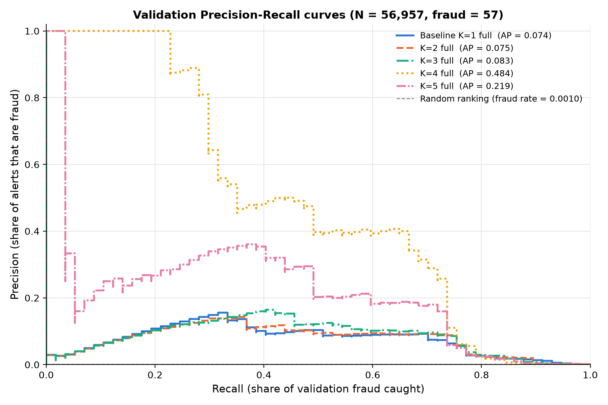

# Phase 1: GMM Triage Evaluation and Model Recommendation

**Project:** Card Fraud Triage via Gaussian Mixture Density Scoring and Autoencoder Anomaly Detection  
**Phase:** Phase 1 — Gaussian Mixture Model (GMM) Anomaly Detection  
**Task:** Member 4 — Anomaly Triage Evaluation (Anurag)  
**Inputs from:** Member 3 model-selection handoff (`reports/gmm_model_selection.md`)  
**Status:** Complete. Recommendation in §9.  
**Date:** October 2026  

---

## 1. Scope

This report evaluates how useful the GMM models are for fraud triage and analyst review, and recommends which one should go to final testing.

Models compared, all on the **same validation transactions**:

| Model | K | Covariance | Free parameters |
| :--- | :---: | :---: | ---: |
| `gmm_baseline_k1_full` (frozen baseline) | 1 | full | 464 |
| `gmm_k2_full` | 2 | full | 929 |
| `gmm_k3_full` | 3 | full | 1,394 |
| `gmm_k4_full` | 4 | full | 1,859 |
| `gmm_k5_full` | 5 | full | 2,324 |

Rules followed:
* Metrics use the saved model artifacts. Models were not retrained to produce them.
* The frozen baseline, the chronological split and Member 3's model-selection outputs were not changed.
* Only validation data was used. Test features and test labels were never loaded. `src/triage_evaluation.py` deliberately does not call `load_processed_data()`, because that helper also loads `y_test`.
* The only refits are diagnostic (§6.3, §7). They use legitimate training rows only, are scored on validation only, and are never saved.

---

## 2. Methodology

### 2.1 Scores
`anomaly_score = -gmm.score_samples(X_val)` is the negative log-likelihood (`src/scoring.compute_anomaly_scores`). A higher score means the transaction is less likely under the legitimate-transaction model, so it is more suspicious.

### 2.2 Score–label alignment
Each model's scores are stored together with their `row_id`. The rows are then **shuffled on purpose**, and the scores are joined back to the labels by `row_id` with a one-to-one merge (`align_scores_with_labels`). A duplicated, missing or unexpected row ID stops the run. The metrics therefore never depend on two arrays happening to be in the same order.

### 2.3 Metrics
| Metric | How it is computed |
| :--- | :--- |
| Average Precision (AP) | `sklearn.metrics.average_precision_score` |
| PR curve | `sklearn.metrics.precision_recall_curve` |
| AP 95% interval | Stratified bootstrap, 1,000 resamples, seed 42 |
| ROC-AUC | `sklearn.metrics.roc_auc_score` (context only) |
| Recall @ FPR ≤ 1% / 5% | `sklearn.metrics.roc_curve`, then recounted from the actual predictions (§3.1) |
| Top-N alert budget | Highest-scoring N transactions (§3.2) |

Accuracy is not used. With 0.10% fraud, a model that flags nothing is 99.9% accurate.

---

## 3. Threshold definitions

The two operating constraints below are **different**, and are reported separately.

### 3.1 Fixed false-positive rate (FPR ≤ x%)
* **What is fixed:** the share of *legitimate* transactions that may be flagged.
* **What varies:** the number of alerts, which equals the false positives allowed plus however many fraud cases score above the threshold.
* **Rule:** a transaction is flagged when `score >= threshold`. Out of the thresholds `roc_curve(drop_intermediate=False)` returns (one per distinct score), we take the **lowest one whose FPR ≤ limit**.
* **Ties:** tied scores always get the same decision. If a tied group would push FPR over the limit, the whole group stays unflagged, so the FPR can come out *below* the limit but never above it. The validation set has 56,957 rows but only 55,851 distinct scores, because it contains duplicate transactions.
* **Check:** recall, FPR, TP and FP are recounted from the flags and compared with `roc_curve`. The run fails if the achieved FPR exceeds the limit.
* With 56,900 legitimate rows, 1% FPR allows **≤ 569** false positives and 5% allows **≤ 2,845**.

### 3.2 Fixed analyst-review budget (top N alerts)
* **What is fixed:** the number of alerts analysts can review (N = 50, 100, 200, 500, 570).
* **What varies:** the FPR, which is whatever the false positives inside the top N add up to.
* **Rule:** flag the N highest-scoring transactions. If tied scores straddle the cut-off, the whole tied group is left out, so the budget is never exceeded. On this validation set no tie fell on any of these cut-offs, so every budget produced exactly N alerts.

A budget of 570 alerts is **not** the same as 1% FPR. The 1% FPR threshold produces about 608–612 alerts, because the true frauds come on top of the 566–569 false positives. 570 alerts correspond to roughly 0.93% FPR.

---

## 4. Verification checks

| Check | Result |
| :--- | :--- |
| Validation size / fraud / prevalence | **56,957 rows, 57 fraud, 0.1001%**, matching `preprocessing_metadata.json` |
| Row IDs vs. `data/splits/split_manifest.csv` | Identical set of 56,957 IDs, unique, in increasing order (170,888 – 227,844) |
| Train/validation overlap | 0 row IDs |
| Same rows and labels for every model | Yes. One `row_ids_val` / `y_val` pair, and every model is scored on all 56,957 rows |
| Scores finite | Yes, for all 5 models |
| Higher score = more suspicious | Yes, for all 5. The fraud median is far above the legitimate median, and AP with the scores flipped is about 0.0005, below the fraud rate |
| Baseline rescored vs. frozen `gmm_baseline_scores_val.csv` (joined by `row_id`) | Max abs. difference 4.5 × 10⁻¹³ |
| Artifacts | All converged, 29 features, trained on the 170,528 legitimate training rows, 360 training frauds excluded |
| AP vs. Member 3's metadata | Identical to 6 decimal places |
| Thresholds vs. Member 3's report | Recall counts identical. Member 3's interpolated `np.percentile` thresholds flagged **570 / 571** legitimate rows at "1% FPR" for the baseline and K=4, slightly over the 569 allowed. The thresholds in this report are guaranteed to stay within the limit. Member 3's outputs were left unchanged, and the difference is documented here |
| Test-set leakage | None. No test file is opened by any evaluation code path |

Full record: [`results/tables/triage_validation_checks.json`](../results/tables/triage_validation_checks.json).

---

## 5. Model performance comparison

Source: [`results/tables/triage_model_comparison.csv`](../results/tables/triage_model_comparison.csv). All rows: N = 56,957, fraud = 57.

| Model | AP | AP 95% CI | ROC-AUC | Recall @ 1% FPR | τ (1%) | Alerts / FP (1%) | Recall @ 5% FPR | τ (5%) | Alerts / FP (5%) |
| :--- | ---: | :---: | ---: | ---: | ---: | ---: | ---: | ---: | ---: |
| Baseline K=1 | 0.074 | 0.055 – 0.105 | **0.955** | 73.7% (42) | 158.81 | 608 / 566 | 87.7% (50) | 60.73 | 2,895 / 2,845 |
| K=2 full | 0.075 | 0.056 – 0.105 | 0.949 | **75.4% (43)** | 88.77 | 612 / 569 | **89.5% (51)** | 55.42 | 2,896 / 2,845 |
| K=3 full | 0.083 | 0.060 – 0.115 | 0.949 | **75.4% (43)** | 76.27 | 612 / 569 | 87.7% (50) | 55.94 | 2,895 / 2,845 |
| K=4 full | **0.484** | 0.358 – 0.609 | 0.935 | **75.4% (43)** | 66.44 | 610 / 567 | 82.5% (47) | 50.24 | 2,892 / 2,845 |
| K=5 full | 0.219 | 0.147 – 0.324 | 0.937 | 73.7% (42) | 61.96 | 611 / 569 | 86.0% (49) | 46.21 | 2,894 / 2,845 |

### 5.1 Precision–Recall curves



[`results/figures/triage_precision_recall_curve.png`](../results/figures/triage_precision_recall_curve.png). Each model has its own colour **and** line style, and the AP appears in the legend. The grey dashed line is a random ranking, at the fraud rate.

The curves show where the models differ. K=4, and to a lesser extent K=5, keep high precision for the first 25–40% of recall. K≤3 never get above about 16% precision. Past about 75% recall, all five curves meet near the floor.

---

## 6. Review-capacity and threshold trade-offs

### 6.1 Fixed analyst budget (top-N alerts)
Source: [`results/tables/triage_review_capacity.csv`](../results/tables/triage_review_capacity.csv). Each cell shows **frauds caught / precision**. False positives = N − frauds caught.

| Alerts reviewed (N) | Baseline K=1 | K=2 | K=3 | K=4 | K=5 |
| ---: | :---: | :---: | :---: | :---: | :---: |
| 50 | 1 / 2.0% | 1 / 2.0% | 1 / 2.0% | **25 / 50.0%** | 15 / 30.0% |
| 100 | 4 / 4.0% | 2 / 2.0% | 4 / 4.0% | **38 / 38.0%** | 28 / 28.0% |
| 200 | 22 / 11.0% | 21 / 10.5% | 26 / 13.0% | **42 / 21.0%** | 37 / 18.5% |
| 500 | 40 / 8.0% | **43 / 8.6%** | 42 / 8.4% | **43 / 8.6%** | 42 / 8.4% |
| 570 | 41 / 7.2% | **43 / 7.5%** | **43 / 7.5%** | **43 / 7.5%** | 42 / 7.4% |

Recall = frauds caught / 57. Examples: K=4 with 100 alerts catches 66.7% of fraud at 0.11% FPR; the baseline with 100 alerts catches 7.0%.

### 6.2 FPR-based thresholds
Source: [`results/tables/triage_fpr_thresholds.csv`](../results/tables/triage_fpr_thresholds.csv). Each cell shows **alerts → frauds caught (precision)**.

| FPR limit | Baseline K=1 | K=2 | K=3 | K=4 | K=5 |
| ---: | :---: | :---: | :---: | :---: | :---: |
| 0.1% | 57 → 1 (1.8%) | 57 → 1 (1.8%) | 57 → 1 (1.8%) | **93 → 37 (39.8%)** | 80 → 25 (31.2%) |
| 0.5% | 313 → 29 (9.3%) | 313 → 29 (9.3%) | 317 → 33 (10.4%) | **326 → 42 (12.9%)** | **326 → 42 (12.9%)** |
| 1% | 608 → 42 (6.9%) | 612 → 43 (7.0%) | 612 → 43 (7.0%) | 610 → 43 (7.0%) | 611 → 42 (6.9%) |
| 2% | 1,182 → 44 (3.7%) | 1,182 → 44 (3.7%) | 1,182 → 44 (3.7%) | **1,183 → 45 (3.8%)** | 1,182 → 44 (3.7%) |
| 5% | 2,895 → 50 (1.7%) | **2,896 → 51 (1.8%)** | 2,895 → 50 (1.7%) | 2,892 → 47 (1.6%) | 2,894 → 49 (1.7%) |

### 6.3 What the trade-offs show
* **Tight capacity (≤ 200 alerts, ≤ 0.5% FPR):** the models are very different. K=4 catches 25–42 frauds where the baseline and K=2/K=3 catch 1–26.
* **Agreed operating point (1% FPR, about 610 alerts) and budgets of 500–570:** the models are effectively **tied** at 41–43 of 57. A one-fraud difference is 1.75 percentage points of recall and is not meaningful with 57 cases.
* **Loose capacity (5% FPR, about 2,900 alerts):** K=2 is best (51) and K=4 is worst (47). By then precision is below 2%, which is about 57 false alerts for every fraud caught.
* 13 of the 57 validation frauds are missed by **every** model at 1% FPR (together, the five models catch 44 distinct frauds). These frauds look like normal transactions to all of the density models.

---

## 7. Is the K=4 result real?

### 7.1 Audit of the saved artifact (passed)
| Question | Check | Result |
| :--- | :--- | :--- |
| Scores aligned with labels? | Shuffle, then rejoin by `row_id` | AP unchanged (0.4840) |
| Would a misalignment be caught? | Shift scores by one row | AP collapses to 0.0010 (the fraud rate) |
| Driven by label structure? | 100 label permutations | Mean AP 0.0011, max 0.0018 |
| Same rows as the other models? | Shared `row_ids_val`, checked against the manifest | Yes |
| Labels or validation/test data in fitting? | `--refit-check`: refit on legitimate training rows only (`reg_covar=1e-6, n_init=5, random_state=42`) | Means, covariances and validation scores **bit-identical** to the artifact |
| Test data in scoring? | Code path | Only `X_val.npy` is scored |

**The 0.484 AP is a real, leak-free property of the saved `gmm_k4_full` artifact.** 13 frauds score above every legitimate validation row (top score 96,758). K=4 has 16 covariance eigenvalues sitting at the `reg_covar = 1e-6` floor. Frauds that leave this near-flat legitimate subspace get extremely large scores, which is why the top of its queue is so clean.

### 7.2 Is the result reproducible? (not as a property of "K=4 full")
`--stability-check` refits K=2, 3 and 4 full on legitimate training rows with other random seeds. Each seed still uses `n_init=5`. Nothing is saved, and only validation is scored. Source: [`results/tables/triage_stability_check.csv`](../results/tables/triage_stability_check.csv).

| Model | Seeds 0, 1, 2, 3, 4, **42 (artifact)** — AP | Frauds in top 100 | Recall @ 1% FPR (range) |
| :--- | :--- | :--- | :---: |
| K=2 full | 0.641, 0.080, 0.634, 0.634, 0.372, **0.075** | 41, 4, 39, 39, 30, **2** | 75.4 – 77.2% |
| K=3 full | 0.458, 0.068, 0.068, 0.348, 0.068, **0.083** | 38, 2, 2, 30, 2, **4** | 75.4 – 77.2% |
| K=4 full | 0.092, 0.083, 0.089, 0.102, 0.069, **0.484** | 11, 10, 10, 12, 2, **38** | 71.9 – 75.4% |

Findings:
1. **AP and top-of-queue performance depend on which local optimum EM lands in, not on K.** Every multi-component full model can land on a "high-AP" solution (K=2 seed 0 reaches 0.64) or a "low-AP" one (about 0.07). The K=4 artifact happens to be a high-AP solution. The K=2 and K=3 artifacts happen to be low-AP ones.
2. **Recall at 1% FPR is stable** across every refit (71.9 – 77.2%). The agreed operating point does not depend on the seed.
3. **Can it be justified without labels?** For K=4, the seed-42 artifact has the **highest training log-likelihood** of the six K=4 runs (lower bound 14.21 against 9.22 – 12.51), so picking the best fit by likelihood alone would also select it. This does **not** generalise: for K=2 and K=3, the best-likelihood solution is a low-AP one. Training likelihood cannot be relied on to find good triage solutions.
4. **Selection bias.** Seed 42 was the project's fixed seed and was not tuned on validation. K=4 was preferred over K=2 and K=3 partly *because* of its validation AP, and those APs vary this much from seed to seed. The 0.484 is therefore an optimistic estimate. Only the test set can say how much of it holds.
5. **Regularisation (seed 42 only).** AP stays at 0.48 – 0.52 for `reg_covar` from 1e-6 to 1e-3, and drops to 0.28 at 1e-2. `reg_covar = 1e-3` lowers the worst condition number from 1.9 × 10⁶ to 5.9 × 10³ with no loss on validation. That configuration has no saved artifact and was not tested across seeds.

### 7.3 Complexity and numerical stability
| Model | Parameters | Max condition number | Eigenvalues at the `reg_covar` floor |
| :--- | ---: | ---: | ---: |
| Baseline K=1 | 464 | **6.5** | 0 |
| K=2 full | 929 | 1.6 × 10⁶ | 2 |
| K=3 full | 1,394 | 2.5 × 10⁶ | 9 |
| K=4 full | 1,859 | 1.9 × 10⁶ | 16 |
| K=5 full | 2,324 | 3.5 × 10⁶ | 18 |

All multi-component models are ill-conditioned at `reg_covar = 1e-6`. The baseline is the only well-conditioned model and the only one with a unique solution (K=1 has no local optima).

---

## 8. Answers to the evaluation questions

| Question | Answer |
| :--- | :--- |
| Strongest fraud-ranking performance? | **`gmm_k4_full`** (AP 0.484, CI 0.36 – 0.61; 38 frauds in the top 100). This holds for the saved artifact, not for the K=4 configuration in general (§7.2). |
| Most fraud at the agreed FPR? | At **1% FPR: a tie.** K=2, K=3 and K=4 catch 43/57, and the baseline and K=5 catch 42/57. At 5% FPR, K=2 is best (51/57). |
| Best under a fixed analyst budget? | **`gmm_k4_full`** for budgets of 200 alerts or fewer (25 / 38 / 42 frauds at 50 / 100 / 200). At 500 – 570 alerts, K=2, K=3 and K=4 tie at 43. |
| Does K=4's high AP survive verification? | **Yes for correctness:** aligned, leak-free, reproduced bit-for-bit. **No for robustness:** other seeds of K=4 give AP 0.07 – 0.10. The high AP belongs to this specific fitted solution. |
| Is the improvement worth the complexity and instability? | **Only if analyst capacity is tight.** At or above about 1% FPR there is no gain over the 464-parameter, well-conditioned baseline. At ≤ 200 alerts the gain is about 10× more fraud caught, which is large enough to justify a 1,859-parameter, ill-conditioned model, **provided the frozen artifact is used as is** and the gain is confirmed on test. |
| Which candidate advances, and why? | See §9. |

---

## 9. Recommendation

**Advance the frozen `gmm_k4_full` artifact (`models/candidates/gmm_k4_full.joblib`) to final testing as the primary candidate, with the frozen `gmm_baseline_k1_full` evaluated alongside it as the reference.**

Why:
1. It is the only candidate that materially improves triage when analyst capacity is limited. It catches 38 of 57 frauds in 100 alerts, against 4 for the baseline, at 0.11% FPR.
2. It gives up nothing at the agreed 1% FPR operating point (43/57, the best recall there).
3. It passed every correctness check: alignment, label permutation, leakage, and a bit-identical refit from legitimate training rows.
4. Within K=4, its solution is also the best one by a label-free criterion (training likelihood).

Conditions that come with this recommendation:
* **Freeze the operating points before opening the test set.** Use the validation thresholds: top-100 budget (τ = 135.78), 1% FPR (τ = 66.44) and 5% FPR (τ = 50.24). For the baseline: 530.23, 158.81 and 60.73. Do not re-tune any threshold on test labels.
* **Use the saved artifact, not the recipe.** Retraining "K=4 full" with another seed will most likely *not* reproduce this performance (§7.2). Any retraining must use `random_state=42` and pass `--refit-check`.
* **Decision rule on test:** if K=4's advantage at the top-100 / 0.1% FPR operating points does not hold up on the test set, fall back to the baseline. At 1% FPR the two are equivalent, and the baseline is simpler, well-conditioned and has a unique solution.
* **Not recommended now:** K=2 seed 0 (AP 0.64) or K=4 with `reg_covar = 1e-3` (AP 0.52, better conditioned). Both are tempting, but neither has a saved artifact, and choosing them now would mean picking the best of many validation runs, which makes the selection bias in §7.2 worse. These belong in a separate model-selection follow-up (for example, choosing among restarts with a label-free criterion), not in this hand-off.

---

## 10. Limitations

* Validation only. Nothing here estimates performance on the test period.
* 57 validation frauds. Recall moves 1.75 points per fraud, and the AP intervals are wide.
* The thresholds are calibrated on the same rows they are reported on, so validation recall at those thresholds is optimistic.
* K=4's validation AP is subject to selection bias (§7.2, point 4).
* Analyst capacity is expressed as alerts per validation window. Converting it to alerts per day needs the team's real staffing numbers.
* The seed study uses six seeds per K. That is enough to show instability, but not to estimate how often a "high-AP" solution occurs.

---

## 11. Reproduction

```bash
# Environment (pinned versions as in reports/gmm_model_selection.md §7)
uv venv --python 3.13 .venv
uv pip install --python .venv/bin/python3 numpy==2.5.3 pandas==3.0.6 scikit-learn==1.9.1 scipy==1.18.1 joblib==1.6.0 matplotlib==3.11.2 seaborn==0.13.2

# Full evaluation (~1 min; ~4 min with --stability-check)
./.venv/bin/python3 scripts/run_triage_evaluation.py --refit-check --stability-check

# Tests
./.venv/bin/python3 -m unittest discover -s tests -v
```

| File | Purpose |
| :--- | :--- |
| `src/triage_evaluation.py` | Validation-only loading, manifest check, row-ID alignment, AP / PR, Recall @ FPR, top-N budget, bootstrap CI |
| `scripts/run_triage_evaluation.py` | Entry point, artifact checks, K=4 audit, refit and stability checks |
| `tests/test_triage_evaluation.py` | Known-value, tie, invalid-input, alignment, budget and reproducibility tests |
| `results/tables/triage_model_comparison.csv` | One row per model |
| `results/tables/triage_review_capacity.csv` | Top-N budget trade-offs |
| `results/tables/triage_fpr_thresholds.csv` | FPR-based threshold trade-offs |
| `results/tables/triage_stability_check.csv` | Seed and `reg_covar` refits (validation only) |
| `results/tables/triage_validation_checks.json` | All verification checks |
| `results/figures/triage_precision_recall_curve.png` | Overlaid PR curves |
| `results/tables/triage_pr_curve_data.csv` | Full PR curve points (not committed, ~18 MB) |
